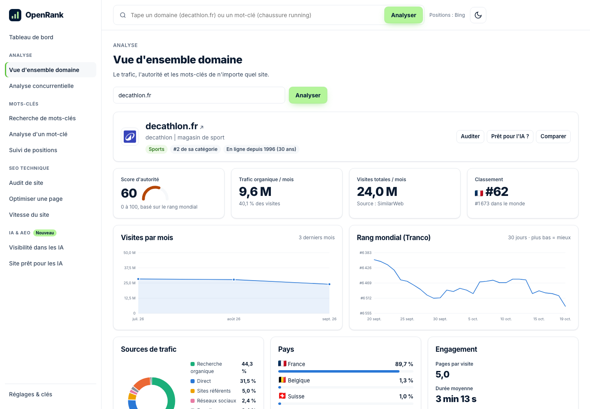

# OpenRank — la plateforme SEO & AEO gratuite et open source

Une alternative libre à Semrush, Ahrefs ou SE Ranking. Pas d'abonnement à 140 €/mois. Tu l'installes sur ton ordinateur, en 2 minutes, et tout reste chez toi.

**SEO** = être trouvé sur Google. **AEO** (Answer Engine Optimization) = être cité par ChatGPT, Claude, Perplexity et Gemini.



## Ce que ça fait

| Outil | Ce que tu obtiens | Équivalent Semrush |
|---|---|---|
| **Vue d'ensemble domaine** | Trafic mensuel, trafic organique, score d'autorité, rang, sources de trafic, pays, engagement, meilleurs mots-clés, trafic venant des IA | Domain Overview |
| **Analyse concurrentielle** | Jusqu'à 5 sites côte à côte + mots-clés en commun | Domain vs Domain |
| **Recherche de mots-clés** | Des centaines d'idées depuis Google, questions, groupes, intention (I/C/T/N), export CSV | Keyword Magic Tool |
| **Analyse d'un mot-clé** | Difficulté, intention, top 10 avec l'autorité de chaque site, questions associées | Keyword Overview |
| **Suivi de positions** | Positions quotidiennes de tes mots-clés, visibilité, concurrents, historique | Position Tracking |
| **Audit de site** | Crawl jusqu'à 500 pages, 23 contrôles (titres, H1, liens cassés, noindex, vitesse, schéma…), score de santé | Site Audit |
| **Optimiser une page** | Score + liste d'actions pour un mot-clé, comparé au top 5 | On Page SEO Checker |
| **Vitesse du site** | Core Web Vitals (avec clé Google gratuite) ou mesure maison | — |
| **Visibilité dans les IA** | On pose les questions de tes clients aux IA : es-tu cité ? à quel rang ? part de voix vs concurrents | AI Visibility Toolkit |
| **Site prêt pour les IA** | robots.txt pour GPTBot/ClaudeBot/PerplexityBot, llms.txt (généré pour toi), schéma, FAQ, rendu sans JS | — |

## Installation (2 minutes)

Il faut [Node.js](https://nodejs.org) version 20 ou plus.

```bash
git clone https://github.com/Saadi2613/openrank.git
cd openrank
npm install
npm start
```

Ouvre **http://localhost:4321**. C'est tout.

### Le mettre en ligne (pour le partager, ouvrir sur mobile)

[](https://render.com/deploy?repo=https://github.com/Saadi2613/openrank)

Un clic, gratuit. En ligne, OpenRank passe en **mode public** (`PUBLIC_MODE=1`) :
- chaque visiteur garde ses projets, audits et tests IA **dans son navigateur** : personne ne voit ceux des autres ;
- les clés API sont verrouillées (tu les mets dans les variables d'environnement de l'hébergeur) ;
- des limites anti-abus protègent ton serveur et tes clés (audits de 100 pages max, 20 mots-clés par projet…) ;
- les adresses internes (localhost, réseau privé) ne peuvent pas être analysées.

L'offre gratuite de Render met le site en veille après 15 min sans visite : le premier chargement suivant prend ~1 minute.

## Gratuit par défaut, plus précis avec des clés

Tout marche sans aucune clé. Chaque clé optionnelle débloque un bonus. Ajoute-les dans l'app (**Réglages**) ou dans un fichier `.env` (copie `.env.example`).

| Clé | Prix | Débloque |
|---|---|---|
| `GROQ_API_KEY` | Gratuit | Test de visibilité IA (modèles open source) |
| `SERPER_API_KEY` | 2 500 recherches offertes | Positions Google réelles (sinon : Bing) |
| `GOOGLE_API_KEY` | Gratuit | Core Web Vitals officiels (PageSpeed) |
| `OPENPAGERANK_API_KEY` | Gratuit | Score d'autorité plus précis |
| `OPENAI_API_KEY` | Quelques centimes | Test dans ChatGPT |
| `ANTHROPIC_API_KEY` | Quelques centimes | Test dans Claude |
| `DATAFORSEO_LOGIN` + `DATAFORSEO_PASSWORD` | ~0,05 € / 100 mots-clés | Volumes de recherche exacts |

## D'où viennent les données

Soyons honnêtes : Semrush paie des millions pour sa base de données. OpenRank assemble des sources publiques et gratuites :

- **Trafic, pays, sources, mots-clés, trafic IA** : données publiques SimilarWeb.
- **Rang mondial** : [Tranco](https://tranco-list.eu) (liste académique).
- **Âge du domaine** : Wayback Machine (archive.org).
- **Idées de mots-clés** : suggestions Google. Sans clé DataForSEO, le volume est remplacé par un score de **popularité** (1-100).
- **Positions** : Bing (gratuit) ou Google via Serper.
- **Score d'autorité** : calculé depuis le rang mondial (et Open PageRank si clé). C'est une estimation, pas le chiffre officiel de Semrush.
- **Audit, on-page, AEO** : calculés par OpenRank en lisant ton site directement. 100 % exact.

Les très petits sites n'apparaissent pas dans les classements publics : pas de trafic estimé, mais l'audit, le suivi de positions et l'AEO marchent.

## Vie privée

- Le serveur écoute uniquement sur ta machine (`127.0.0.1`).
- Tes projets et audits sont dans `data/db.json`. Tes clés dans `.env`. Les deux sont ignorés par Git.

## Structure

```
server.js          serveur HTTP + routes API
lib/domain.js      vue d'ensemble domaine
lib/keywords.js    idées de mots-clés, difficulté
lib/serp.js        résultats Bing / Google (Serper)
lib/tracking.js    suivi de positions + vérification quotidienne
lib/audit.js       crawler et audit de site
lib/page.js        analyse SEO d'une page
lib/onpage.js      optimiseur de page
lib/speed.js       vitesse
lib/aeo.js         préparation IA + test de visibilité dans les IA
public/            interface (HTML/CSS/JS sans framework, sans build)
```

Aucune étape de build. Une seule dépendance (`cheerio`).

## Contribuer

Les contributions sont bienvenues : nouvelles sources de données gratuites, nouveaux contrôles d'audit, traductions. Voir [CONTRIBUTING.md](CONTRIBUTING.md).

## Licence

MIT. Fais-en ce que tu veux.

OpenRank n'est pas affilié à Semrush. Les marques citées appartiennent à leurs propriétaires.
